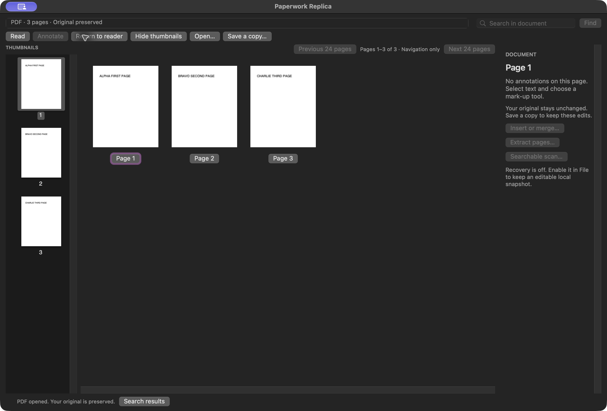

# Paperwork Replica

An original, local-first macOS PDF workspace that recreates selected reader and page-navigation workflows observed in PDF Expert 3.13.4. It is an independent project and is not affiliated with Readdle, Apple, or Adobe.

The native AppKit interface provides a single open document, continuous PDF reading, left-side page thumbnails, page overview with direct navigation, text search results with page navigation, supported local markup and form operations, and create-only Save a Copy workflows. It uses Apple PDFKit plus the shared Paperwork Core implementation. The opened source PDF is preserved; edits are made in a working copy. A single-document workspace is deliberate: this build does not claim to reproduce multi-tab document management.

## Try or build

If [Releases](https://github.com/Ghostzy0/pip-paperwork-replica/releases) lists a packaged prerelease, its entry provides the download and checksums. Local packages are ad-hoc signed, without Developer ID or notarisation. Use the normal macOS per-app opening flow if offered; do not disable Gatekeeper globally.

Requirements: Apple silicon Mac, macOS 14 or later, and Xcode Command Line Tools. The first helper build downloads the exact Go toolchain after verifying its checksum; no system Go installation is needed. From the exported repository root:

```sh
./scripts/build.sh
./scripts/test.sh
```

Build output is `build/Paperwork Replica.app`. The current runtime source passed 36 tests and a production build in hosted macOS 14 CI. A matching local package has been exercised on macOS 27.0.1: the three-page overview shows complete cards and labels, and a 26-page fixture supports scrolling, batch navigation and return to the correct reader page. [TESTING.md](TESTING.md) gives exact package identity and limits. Minimum-window, VoiceOver and macOS 14 GUI acceptance remain open. This is an experimental alpha with selected workflows verified, not complete PDF Expert fidelity.

## Actual overview example

Captured from the local package whose runtime sources match public revision [`dc8e52c`](https://github.com/Ghostzy0/pip-paperwork-replica/commit/dc8e52c4fa8c3f108e50ba98338dc60f5724c87c), using an authored synthetic three-page document. The binary was compiled from the equivalent development snapshot; it was not rebuilt from that public commit.



The overview is navigation-only. A batch contains at most 24 pages and scrolls horizontally when needed; select a page button to return to reading.

## Guides

- [How to use Paperwork Replica](docs/HOW-TO.md)
- [Frequently asked questions](docs/FAQ.md)
- [AI setup prompt](docs/AI-SETUP.md)
- [Security and privacy](docs/SECURITY.md)
- [Contributing](docs/CONTRIBUTING.md)

## Privacy and limits

Documents are processed locally. No account, cloud service, trial, premium mode, AI service, cryptographic signing, redaction, text replacement, or vendor integration is included. Encrypted and signed PDFs remain read-only under the shared core policy. Save operations refuse to replace existing files. OCR creates flattened searchable copies and can make recognition errors. Supported form fields only; executable and remote PDF actions remain disabled.

See [PARITY.md](PARITY.md) for evidence boundaries, [docs/REFERENCE-WORKFLOW.md](docs/REFERENCE-WORKFLOW.md) for the required reference/evidence workflow, and [Engine/Notices/README.md](Engine/Notices/README.md) for third-party notices. Private reference captures and machine-specific paths are never part of this export.
